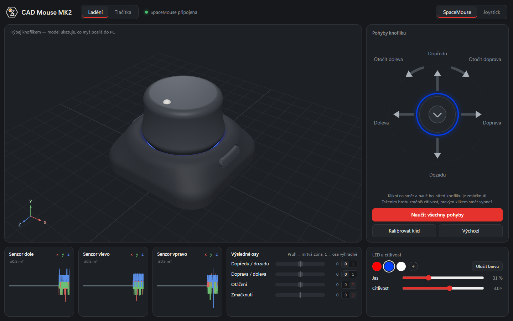
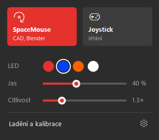

# CAD Mouse MK2 – firmware & Windows app

Extended firmware and a Windows companion app for the DIY 6DoF space mouse
**[CAD Mouse MK2](https://github.com/sb-ocr/cad-mouse-mk2)** by *salimbenbouz* (Salim Benbouziyane).
Hardware, PCBs, enclosure and build guide are in the original project
([Instructables](https://www.instructables.com/CAD-Mouse-MK2-a-6DoF-Space-Mouse-Using-Magnets)) –
this repository is only the software side.

> ⚠️ The app UI is currently in **Czech**. Labels are short and the layout is visual, so it is usable,
> but translations are welcome.





## What it does

**Firmware (XIAO RP2040)**
- Two USB modes, switchable from the tray icon (stored in flash):
  - **SpaceMouse** – shows up as a 3Dconnexion SpaceMouse Pro, works in Blender, slicers (Bambu Studio…),
    and with 3DxWare in SolidWorks, Inventor, Onshape, FreeCAD…
  - **Joystick** – plain 6-axis game controller with 32 buttons (games, flight sims).
- **Motion teaching** – push/tilt/twist the knob in each direction once and the mouse learns
  your hardware (magnet placement, spring stiffness) instead of hand-tuned gains.
- **Exclusive axes** – an axis can be made "exclusive" so small cross-talk from other axes is suppressed.
- Per-axis dead zones and sensitivity, LED colour + brightness, favourite colours.
- **Sleep** after 3 minutes of inactivity (LED off, knob ignored), wake it with a side button.
- Settings live in flash; axis remapping and "press = zoom" are set at runtime over the serial port.

**Tray app (`CadMouseTray.exe`)**
- Icon next to the clock showing the mode and LED colour; click for a Windows 11-style quick menu
  (mode, colour, brightness, sensitivity).
- **App window** (WebView2, no browser needed): live 3D model of the mouse, motion teaching,
  rest calibration, dead zones, button setup.
- **Side buttons → keyboard shortcuts per program** in the foreground (presets for Fusion, Blender,
  Bambu Studio; add any running program).
- **Axis mapping per program** (e.g. Blender: tilt = pan), knob press as zoom.
- Bridge COM port ↔ local WebSocket/HTTP server on `localhost:47390` used by the window and the Fusion add-in.

**Fusion add-in (`CadMouseNav`)**
- Orbit / roll / zoom in Autodesk Fusion **without 3DxWare**, reading data from the tray app.
- Side buttons can trigger Fusion actions that have no shortcut (Home, Fit, standard views, ortho, wireframe…).

## Install

Download `CadMouseMK2-vX.Y.zip` from **[Releases](../../releases)** and extract it to a writable folder
(e.g. `Documents\CadMouseMK2`, not Program Files).

1. **Firmware** – hold **BOOT** on the XIAO RP2040, plug in USB, copy `firmware\firmware.uf2`
   to the **RPI-RP2** drive. The mouse reboots.
2. **Tray app** – run `tray\CadMouseTray.exe`, right-click the tray icon → *Spouštět s Windows*
   (start with Windows). SmartScreen may warn (unsigned exe): *More info → Run anyway*.
3. **Fusion** (optional) – `Shift+S` → *Add-Ins* → **+** → pick folder `fusion-addin\CadMouseNav`,
   tick *Run on Startup*, press *Run*.
4. **Calibrate** – left-click the tray icon → *Ladění a kalibrace* → **Naučit všechny pohyby**
   (teach all motions) and follow the prompts.

### Requirements
- Windows 10 or 11, x64.
- [WebView2 Runtime](https://developer.microsoft.com/microsoft-edge/webview2/) – already part of Windows 11
  and most Windows 10 installs.
- .NET Framework 4.6.2+ (part of Windows 10/11).

### 3DxWare and other CAD programs
- **Fusion** works with the add-in alone – no 3DxWare needed.
- **Blender** and slicers read the SpaceMouse directly – no 3DxWare needed.
- **SolidWorks, Inventor, Onshape, FreeCAD** and others need the official **3DxWare** driver from
  3Dconnexion – install it yourself. In SpaceMouse mode the mouse is recognised as a SpaceMouse Pro.
- With 3DxWare installed, **use only one of them in Fusion**: either disable 3DxWare for Fusion, or
  stop the `CadMouseNav` add-in – otherwise the view moves twice.

### Firmware variants
| File | USB ID in SpaceMouse mode | Works with |
|---|---|---|
| `firmware.uf2` | `256F:C631` (3Dconnexion SpaceMouse Pro) | everything above |
| `firmware-generic-vid.uf2` | `2E8A:0CAE` | Fusion add-in, Joystick mode, the app – **not** Blender/slicers/3DxWare |

Blender, slicers and 3DxWare only recognise a space mouse by the 3Dconnexion USB vendor ID, so the default
build reuses it. That ID belongs to 3Dconnexion; this project is not affiliated with them. Use the generic
variant if you do not want that. Joystick mode always uses `2E8A:0CAD`.

## Build from source

**Firmware** – [PlatformIO](https://platformio.org/):
```
pio run -e seeed_xiao_rp2040      # or -e generic_vid
```
Output: `.pio/build/<env>/firmware.uf2`. `tools\flash-firmware.ps1` builds and flashes in one go.

**Tray app** – no Visual Studio needed, uses the C# compiler built into Windows:
```
powershell -ExecutionPolicy Bypass -File tools\build-tray.ps1
```
It downloads the WebView2 SDK dlls from NuGet (pinned version, checked by SHA256) and writes
`app\tray\CadMouseTray.exe`. The exe expects the web UI in `..\ladeni-web` relative to its folder.

**CI** – `.github/workflows/build.yml` builds both and packs the zip; a `v*` tag publishes it as a release.

## Repository layout
```
platformio.ini            PlatformIO project (envs: seeed_xiao_rp2040, generic_vid)
firmware/                 firmware sources (fork of sb-ocr/cad-mouse-mk2)
app/tray/                 CadMouseTray.cs + icon
app/ladeni-web/           app window UI (HTML/JS, three.js, STL models)
fusion-addin/CadMouseNav/ Fusion add-in (Python)
tools/                    build & flash scripts
```

## Security
The tray app runs a small HTTP/WebSocket server bound to `localhost:47390`. Connections carrying a browser
`Origin` other than the app itself are refused (403), so random web pages cannot send commands or keystrokes.
The app window only navigates to its own local page.

## License
- **Firmware** (`firmware/`, `platformio.ini`) and the **STL models** in `app/ladeni-web/model/` are derived from
  CAD Mouse MK2 by salimbenbouz and stay under **[CC BY-NC-SA 4.0](LICENSE-CC-BY-NC-SA-4.0.txt)** –
  non-commercial, share-alike, attribution required.
- **Tray app, app UI, Fusion add-in and tools** – **[GPL-3.0-or-later](LICENSE-GPL-3.0.txt)**: you may use,
  change and share them, but modified versions you distribute must stay open under the GPL.
- **Logo** (`logo.png`, `cadmouse.ico`) – **all rights reserved**, not GPL. Keep it unmodified in your copy or
  remove it, but don't use it for other things or to pass yourself off as the author. Details in [LICENSE.md](LICENSE.md#logo).
- Third party: three.js (MIT), WebView2 SDK (Microsoft, BSD-style, redistributable – included in the release zip
  as `WebView2-LICENSE.txt`).

---

## Česky

Rozšířený firmware a aplikace pro Windows k DIY 6DoF myši **CAD Mouse MK2** (původní projekt salimbenbouz).
Umí režimy SpaceMouse/Joystick, učení pohybů tahy knoflíkem, výhradní osy, spánek, ikonku v liště
s rychlým menu, okno aplikace (WebView2) s 3D modelem, zkratky bočních tlačítek a mapování os podle programu
v popředí a navigaci ve Fusionu bez 3DxWare přes doplněk CadMouseNav.

**Instalace:** stáhni zip z Releases a rozbal do své složky (ne do Program Files).
1. Podrž **BOOT** na XIAO, připoj USB, zkopíruj `firmware\firmware.uf2` na disk **RPI-RP2**.
2. Spusť `tray\CadMouseTray.exe`, pravým na ikonku → *Spouštět s Windows*.
3. Fusion: `Shift+S` → *Add-Ins* → **+** → složka `fusion-addin\CadMouseNav`, *Run on Startup*.
4. Klikni na ikonku → *Ladění a kalibrace* → **Naučit všechny pohyby**.

SolidWorks, Inventor, Onshape, FreeCAD potřebují 3DxWare – nainstaluj si ho sám. Když ho máš, ve Fusionu
vypni buď 3DxWare, nebo doplněk (jinak se pohled hýbe dvakrát).

**Licence:** firmware a STL – CC BY-NC-SA 4.0 (z originálu), aplikace a doplněk – GPL-3.0. Logo není pod
GPL: ve své kopii ho můžeš nechat beze změny nebo odstranit, ale nesmíš ho používat jinde ani se za autora
vydávat. Podrobně v [LICENSE.md](LICENSE.md).
